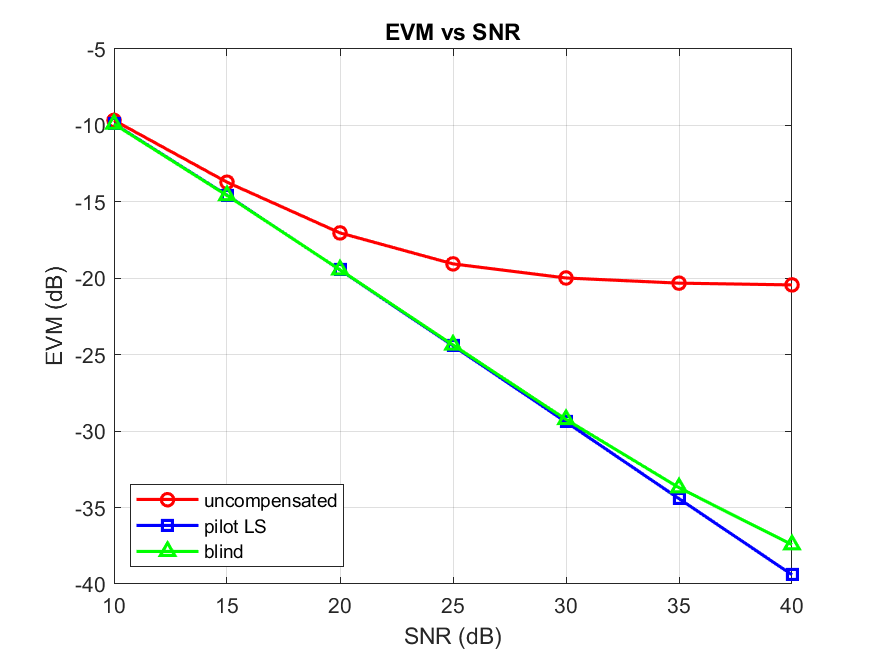
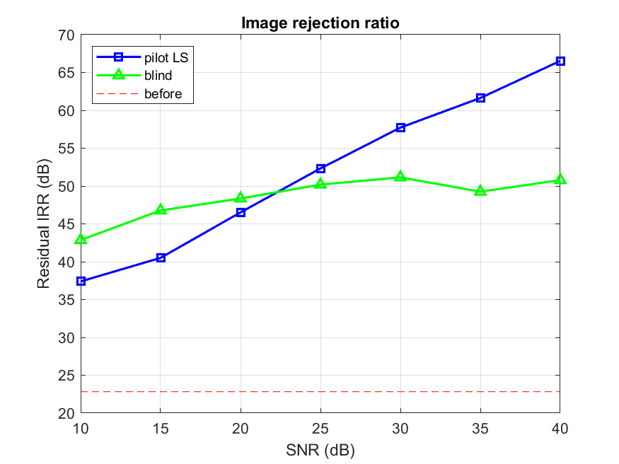
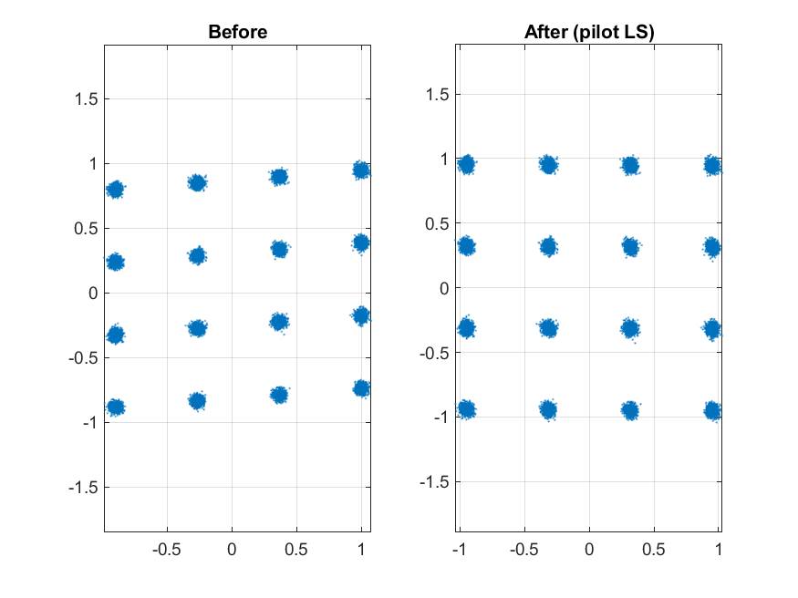

# RF IQ Imbalance Estimation and Compensation (MATLAB / Octave)


Estimates and compensates transmitter/receiver IQ imbalance and DC offset on complex baseband data. Pure MATLAB/Octave, **no toolboxes** (no `qammod`). Works on simulated data or on recorded IQ files (`.mat`, `.csv`, `.cf32`, `.wav`).

## Model

Q branch gain `g = 10^(gain_dB/20)`, phase error `phi`; I branch is ideal:

    y_I = x_I,    y_Q = g ( sin(phi) x_I + cos(phi) x_Q )

Equivalent widely-linear form:

    r = mu x + nu conj(x) + dc + n
    mu = (1 + g e^{j phi}) / 2,   nu = (1 - g e^{-j phi}) / 2
    IRR = 20 log10(|mu| / |nu|)

Compensation is the exact inverse:

    x_hat = ( conj(mu) (r - dc) - nu conj(r - dc) ) / ( |mu|^2 - |nu|^2 )

## Estimators

| Function | Needs | Notes |
|---|---|---|
| `estimate_iq_pilot` | known pilot symbols | LS fit of `[mu nu dc]`; noise-robust; few pilots suffice |
| `estimate_iq_blind` | nothing (circular signal, e.g. square QAM) | uses `E[z^2]` circularity; needs many samples, ~1.5 % EVM at N=2e4 (noiseless) |

Metrics: `iq_metrics` (EVM %, dB), `irr_db` (impairment IRR or residual IRR after compensation).

## Usage

```matlab
addpath src
x  = generate_qam(20000, 16);
r  = apply_iq_imbalance(x, -1, 5, 0.05+0.03j, 30);   % gain dB, phase deg, DC, SNR dB
est = estimate_iq_pilot(r, x(1:256));
xh = compensate_iq(r, est);
[evm_pct, evm_db] = iq_metrics(x, xh);

% real recording, blind:
r  = load_iq('capture.cf32');
xh = compensate_iq(r, estimate_iq_blind(r));
```

Run the simulation sweep (writes figures to `docs/`) and the tests:

```matlab
run('examples/run_demo.m')
addpath tests; run_tests
```

## Results

Figures are generated by `examples/run_demo.m`.







With pilot LS the residual EVM follows the noise floor `s2 (|mu|^2+|nu|^2) / (|mu|^2-|nu|^2)^2` (about -29.4 dB at 30 dB SNR), verified in the tests.

## Limitations

- Frequency-independent (memoryless) imbalance only. Wideband front-ends with frequency-dependent IQ mismatch need an FIR (widely-linear equaliser) extension.
- Blind estimation assumes a zero-mean, circular constellation and does not recover absolute gain/phase rotation.

## License

MIT
